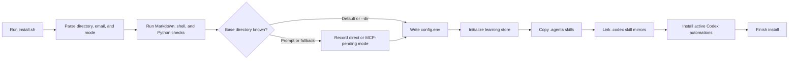
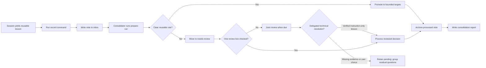
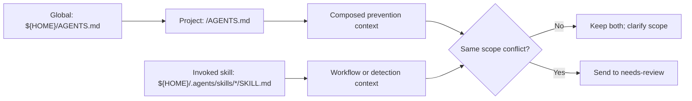
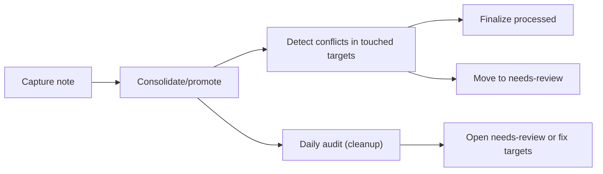
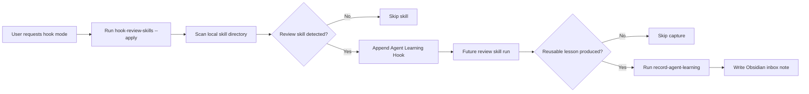
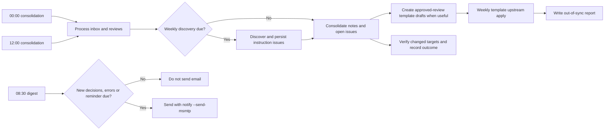

# Agent Learning System

Local Codex skills and automations for capturing real debugging and review
learnings, storing them in a filesystem-backed Markdown tree, and promoting
reusable lessons into agent instructions and review skills.

## Table of Contents

- [Purpose](#purpose)
- [Repository Layout](#repository-layout)
- [Install](#install)
- [Full Pipeline Setup](#full-pipeline-setup)
- [Four-Project Ecosystem](#four-project-ecosystem)
- [Learning Store](#learning-store)
- [Joint Review and Delegated Resolution](#joint-review-and-delegated-resolution)
- [Instruction and Skill Context](#instruction-and-skill-context)
- [Conflict Detection Levels](#conflict-detection-levels)
- [Architecture](#architecture)
- [Session Learning](#session-learning)
- [Skills](#skills)
- [Review Skill Hooks](#review-skill-hooks)
- [Automations](#automations)
- [Validation](#validation)

## Purpose

The system keeps learning lightweight and auditable:

- session-level findings are recorded as Obsidian notes;
- processed notes are kept as history, not deleted;
- daily consolidation reads new inbox notes, review decisions and related
  pending cohorts when joint review is due;
- reusable lessons are promoted to the smallest useful target;
- consolidation never commits or pushes; release preparation opens a PR for
  user approval and merge.

## Repository Layout

```text
.
├── README.md
├── CHANGELOG.md
├── AGENTS.md
├── config.example.env
├── install.sh
├── automations/
│   ├── consolidation.md
│   ├── midnight-consolidation.md
│   ├── morning-review-email.md
│   ├── noon-consolidation.md
│   ├── weekly-rule-audit.md
│   └── weekly-release-pr.md
├── docs/
│   ├── agent-ecosystem-architecture.md
│   ├── auto-learning-pipeline-automations.md
│   ├── composable-learning-architecture.md
│   └── session-learning.md
├── scripts/
│   ├── agent_learning.py
│   ├── check.sh
│   └── learning_pipeline.py
├── skills/
│   ├── consolidate-agent-learnings/
│   └── record-agent-learning/
└── tests/
    └── test_agent_learning.py
```

## Install

Run:

```bash
./install.sh
```

The installer:

- detects the active Obsidian vault as a convenient default filesystem path;
- writes `~/.config/agent-learning-system/config.env`;
- creates the learning store folders;
- copies both skills into `~/.agents/skills`;
- links `~/.codex/skills` to the installed `~/.agents/skills` copies;
- provides setup guidance for the Agent Learning Codex scheduled tasks;
- validates Markdown, shell, and Python files.

Pass `--dir PATH` to choose any filesystem directory as the learning-store base.
The store itself is created as `PATH/AI Agent Learnings/`. If `PATH` is inside
an Obsidian vault, Obsidian will show the Markdown notes automatically; no
Obsidian API or MCP server is required.

Configure the scheduled tasks in Codex after installation. The installer leaves
existing tasks untouched and prints the setup location by default; pass
`--skip-automations` to omit this reminder. If the Obsidian provider is
`mcp-pending`, configure filesystem access or a working MCP setup before
enabling consolidation tasks.

Pass `--email ADDRESS` before relying on the morning review email. Without it,
the installer records a reserved example address and the morning notification
flow will not send mail.

If the default Obsidian vault is not found, the installer asks for a direct
filesystem directory path or records MCP mode as pending. Direct filesystem
access is the recommended mode for this project because the automation only
needs local Markdown files.

This setup flow follows `install.sh`, including validation, config creation,
skill copy installation, Codex mirrors, automation setup guidance, and local
checks.



## Full Pipeline Setup

For the complete two-repository auto-learning pipeline, install this repository
and the template repository, then ensure the weekly audit and template upstream
automations exist.

Follow
[`docs/auto-learning-pipeline-automations.md`](docs/auto-learning-pipeline-automations.md)
when asking an AI agent to create or repair the Codex automations. The runbook
covers:

| Component | Repo |
| --- | --- |
| Daily note consolidation | `agent-learning-system` |
| Morning review notification | `agent-learning-system` |
| Weekly duplicate and conflict audit | `agent-learning-system` |
| Weekly release PR preparation | `agent-learning-system` |
| Approved template draft apply | `agents-file-templates-and-skills` |
| Generated-project refresh reports | `agents-file-templates-and-skills` |

## Four-Project Ecosystem

The learning and template repositories form the core auto-learning pipeline,
but they operate inside a broader ecosystem that also includes the general
`skills` content repository and `skills-installer` distribution wrapper.

The canonical architecture, source-ownership contract, identified weak points,
and phased improvement proposal are documented in
[`docs/agent-ecosystem-architecture.md`](docs/agent-ecosystem-architecture.md).

## Learning Store

The canonical archive lives under `AGENT_LEARNING_DIR` plus
`AGENT_LEARNING_STORE_NAME`.

Example:

```env
AGENT_LEARNING_DIR="/any/filesystem/folder"
AGENT_LEARNING_STORE_NAME="AI Agent Learnings"
```

This creates:

```text
/any/filesystem/folder/AI Agent Learnings/
├── inbox/
├── needs-review/
├── processed/YYYY/MM/
├── reports/
└── state/
    └── processed.json
```

`AGENT_LEARNING_DIR` may be any local filesystem directory. When it points at an
Obsidian vault, Obsidian sees the generated Markdown files as normal notes.

> Source: `scripts/agent_learning.py` commands `record`, `prepare-run`,
> `finalize-note`, `write-report`, `summarize-runs`, and
> `create-template-draft`.

Joint Review is evaluated by the noon and midnight consolidations when at
least eight notes are pending by default; it is not an event-driven execution
at note capture. With delegated review enabled, dirty/untracked projects need
an exact instruction-overlap check, not blanket deferral. If the queue remains
due, `write-report --review-evidence PATH` requires a saved per-note residual
receipt with actual user choices or scoped investigation blockers and current
target hashes. Resolved technical notes must be finalized first.



Review notes contain a stable checkbox block:

```markdown
## Review Decision

<!-- BEGIN AGENT LEARNING REVIEW -->
- [ ] Approve: promote this rule
- [ ] Retry: I edited the rule, reprocess it
- [ ] Reject: do not promote this rule
<!-- END AGENT LEARNING REVIEW -->
```

Archival (`processed`) is separate from verified integration. The
[integration contract](skills/consolidate-agent-learnings/references/integration.md)
requires whole-contract coherence review, owning-source coverage, complete
installed skill parity and refreshed template consumers. Proportionate local,
peer or council evidence is bound to the exact proposal; distribution-only
receipts remain historical proof. `integration-audit` revalidates receipts; configured
`AGENT_LEARNING_REQUIRE_INTEGRATION=1` rejects completed runs with unverified
newly processed notes. Historical notes without receipts remain unverified.

Audit-origin instruction changes without a source note use
`audit-coherence-source`, `audit-coherence-proposal` and `audit-coherence-check`
to bind independent review to current audit findings and exact target preimages.
The [coherence contract](skills/consolidate-agent-learnings/references/coherence.md)
describes the manifest and evidence; this path does not certify note integration.

The consolidator reads `inbox/`, `needs-review/`, and `state/processed.json`.
It does not reread `processed/` history unless resolving a duplicate or
conflict.

`prepare-run` groups related inbox and pending-review notes as candidate cohorts
and project contexts. These are discovery hints: each source still needs its own
evidence and outcome. Individual reads are bounded; `inventory_complete: false`
and `unavailable_sources` indicate unknown content, never an empty queue. Runs
cannot complete when their initial inbox snapshot was incomplete or a captured
source lacks a recorded finalization.

Use `integration-audit --run-id <RUN_ID> --require-verified` to check the
processed outcomes of a consolidation. During an active run, a strict audit
without an explicit scope automatically checks that run and reports its scope;
use `--all-history --require-verified` for a separate strict historical audit.
Completed consolidation records deferred unrelated issues separately. Release
readiness blocks unresolved issues by default. A scoped assessment may defer an
audit finding or review issue only when the user explicitly authorizes that
exception for the candidate and independent review proves it is unrelated to the
complete candidate and its dependencies. This reconciles relevance for that
candidate only; the issue remains open. Other unresolved issue classes remain
blocking unless covered by an explicitly authorized post-release check. This overrides the default skill
instruction only within the user-approved scope; a receipt alone does not prove
authority.
User decisions, stale evidence and protected reconciliation findings remain blocking. Closed audit cohorts still require current evidence. Explicitly
authorized post-publication checks remain open for the exact candidate.

Fetch `origin/main` before review using `git fetch origin
refs/heads/main:refs/remotes/origin/main`. Save `pipeline-release-assessment` output
to a private file outside the candidate checkout and use `pipeline-status` for
full issue details. Independently review every issue and cohort against the final
candidate diff, and fill the template with the current evidence hashes. Then run `pipeline-release-status
--release-assessment <ASSESSMENT_PATH> --release-version <VERSION>`. The
assessment binds the local target and candidate files as well as issue
fingerprints; changed or unavailable evidence requires a fresh review. Recheck
the remote target with `git ls-remote --heads origin refs/heads/main` before
pushing and compare it to the assessed target commit. If it changed, stop and
refresh and reassess. A reviewer attestation records an assessment;
it does not itself prove semantic correctness. For exact deferral receipt
fields, see [scoped release assessment](docs/scoped-release-assessment.md).
Without an active run, a strict audit must select a scope explicitly; a
non-strict unfiltered audit still reports history. Both strict checks retain
their verification requirements.

For an authorized post-release check, update the existing `investigate`
operational issue with `pipeline-issue --from-json FILE`, setting `post_release`
to an object with `version`, `reason`, absolute saved-report `evidence` and
`authorization` paths,
`candidate_changelog` and a nonempty `candidate_targets` array. The latter two
use `{ "path": "/absolute/path", "sha256": "CURRENT_SHA256" }` references;
the issue must already be an investigation with no prior `candidate` or
`needs-user` history. Audit and Goal reconciliation issues are never eligible.
Candidate files must be under the directory containing the candidate
`CHANGELOG.md`, belong to the same Git repository as the affected targets, and
match their repository-relative paths and hashes. The newest changelog version
must match; the candidate worktree and commit are bound to the assessment. Run
`pipeline-release-status --release-version VERSION`
from that candidate directory. Readiness returns `post_release_checks`; it does
not close them. The authorization receipt records schema version 1, decision
`approved`, verification kind `published-release-readback`, issue ID, release
version, candidate Git identity and a reference to the user's request; it is
traceability evidence, not a cryptographic signature. The coordinator must
verify that the user's authority remains current; local receipt contents alone
do not establish it. The receipt records `thread_id`, timezone-aware
`recorded_at`, and `user_request_reference`, and its `candidate_git` object
contains `root`, `common_dir`, `head` and the canonical GitHub `remote` host and
repository. Candidate checks bind the
affected paths and changelog, not the complete proposed diff; review that diff
separately. Closing the follow-up requires a fresh read-only GitHub release and
remote tag check against the bound candidate commit. Those reads establish a
point-in-time observation, not cross-host exclusion. A changelog with ambiguous
inline comment syntax or raw HTML blocks must be clarified before classification.
Version mismatch, changed evidence, missing candidate files,
unclassified findings, user decisions and other open issues still block it.
Receipt checks have an eight-second per-receipt timeout and a 30-second audit
budget. Timed-out or unchecked receipts remain pending; retry a narrower scope
when the evidence is available. Manifest verification also fails on timeout.
Run scope uses the initial inbox IDs and notes explicitly finalized with that
run's ID. Ambiguous, superseded or legacy outcomes without exact attribution
fail closed instead of being inferred from timestamps.
Partial and failed runs also record an `initial_assessment` with initial
sources lacking a recorded finalization and unavailable inventory entries.
`known: false` means the processed index could not be verified. This accounting
does not prove the quality or integration of a recorded disposition.

Start each new run with `pipeline-begin --run-id <RUN_ID> --runner <noon|midnight>
--goal-mode <scheduled|manual>`. A scheduled run returns an
`initial_fingerprint`. Before creating its user-authorized Goal, record the
actual owning chat with `pipeline-goal-attempt --run-id <RUN_ID>
--goal-thread-id <THREAD_ID>`. Save the actual native Goal output and bind it
with `pipeline-goal-bind --run-id <RUN_ID> --initial-fingerprint <HASH>
--goal-thread-id <THREAD_ID> --goal-receipt <ACTIVE_GOAL_JSON>`;
retry runs and later heartbeats continue that unfinished Goal until it is sealed;
after it is completed and advanced, the next scheduled execution binds a new
Goal. The weekly audit cycle is separate. Check the baseline and bound runs with
`pipeline-goal-status` using the same ID and hash. It
verifies source and archive hashes, flags running or unbound runs, retains
initially unavailable sources as unknown, and reports receipts and review
outcomes. `--seal --goal-receipt <ACTIVE_GOAL_JSON>` revalidates the evidence and requires a current
`--review-evidence` receipt when review is due. Sealing is not semantic approval
or pipeline completion. If a sealed cycle needs more work and its Codex Goal is
still active, `pipeline-goal-reopen` requires the exact seal timestamp, a
reason, and an active Goal receipt. After native Goal completion,
`pipeline-goal-advance` requires that timestamp and a complete Goal receipt before
another cycle can start. It rechecks the sealed sources and review evidence.
Save the result returned by `update_goal` when marking the Goal complete;
`get_goal` can return null after completion. If interrupted before saving,
recover the exact matching completion result from the owning chat's recorded
tool call. A null result alone is not proof of completion.
Confirmed drift records persistent investigation issues and returns
`needs-reconciliation`; the next cycle can proceed without calling the old
outcomes verified. Unavailable evidence remains retryable. Save the actual native Goal output under the store's
reports directory; the file is evidence supplied by the caller, not independent
authentication. Runs created before fingerprints need separate reconciliation.

For a partial or failed run, `pipeline-finish --blocker-scope` records whether
the blocker concerns notes, operations, both, or remains unknown. Reconcile
the original outcome without rewriting it using `pipeline-run-reconcile` and
one or more completed `--followup-run-id` values. The recovery report must
bind the original run fingerprint, explain the resolution, name its blocker
issues and cite hashed evidence; see the installed consolidation skill's
`references/pipeline.md` for the report contract. A recovered run's unknown
runner stays unknown, and changed evidence reopens its operational alert.

## Joint Review and Delegated Resolution

Pending notes are reassessed together at **eight notes by default**. This is a
queue trigger, not a minimum subgroup size: a smaller complementary set may
already resolve uncertainty. `prepare-run.review_analysis` exposes the count,
threshold, cohort fingerprint, candidate project contexts and human precedence.
The agent reads full notes and compares evidence; shared labels alone never
authorize promotion.

Autonomous resolution is opt-in for new installations:

```bash
./install.sh --dir <LEARNING_BASE> --email <RECIPIENT_ADDRESS> \
  --autonomous-review --review-group-threshold 8
```

Configuration keys are `AGENT_LEARNING_AUTONOMOUS_REVIEW` (`0` or `1`, default
`0`) and `AGENT_LEARNING_REVIEW_GROUP_THRESHOLD` (positive integer, default `8`).
Manual mode retains human review. With delegated authority, the agent may apply
verified technical instruction changes or archive already-covered lessons;
technical uncertainty is investigated, and unresolved user choices remain pending.
Preserve existing unrelated changes and distinguish historical routing blockers
from current target state. Application code, live systems and external actions
are outside this delegation.

Each autonomous finalization requires an immutable JSON receipt in the
configured store's `reports/`, passed through `finalize-note --review-evidence`
with `--enforce-routing`. The helper verifies source/target hashes, instruction
scope, classification and absence of open choices; explicit human selections
and ambiguous checkbox blocks take precedence. It records delegated authority
without checking a human approval box. See the
[Joint Review contract](skills/consolidate-agent-learnings/references/joint-review.md)
for the receipt schema, validation and grouped-question workflow.

## Instruction and Skill Context



Project instructions and global instructions are prevention context when they
are loaded before the agent acts. Skills are workflow context: they can be
prevention only when the failing agent would normally invoke that skill before
acting.

## Conflict Detection Levels



The system currently supports a periodic audit via `audit-rules` (see below).

## Architecture

The routing model is documented in
[`docs/composable-learning-architecture.md`](docs/composable-learning-architecture.md).
That document defines prevention targets, detection targets, recurrence
tracking, and draft-first upstreaming into reusable instruction templates.

## Session Learning

The [session learning contract](docs/session-learning.md) connects optional,
explicit Retro analysis with the existing terminal Auto Learn and capture path.
It covers independent comparisons, applied-versus-proposed evidence, source-run
capture identity and maintenance of instruction/check cost. No retrospective
runs automatically after each review batch.

The [three-session pilot](docs/retro-pilot.md) records the independent baseline
comparison, reconciliation and observed work without publishing raw session logs.

## Skills

### `record-agent-learning`

Use after a session produces a real reusable finding, fix, regression, or
workflow correction. It writes one structured note to `inbox/`.

It also has an explicit hook mode for user-requested setup. Hook mode scans the
local skill directory for review-oriented skills and appends an idempotent
`Agent Learning Hook` section to each detected target. It does not run during
ordinary one-off capture.

### `consolidate-agent-learnings`

Use from scheduled automation or manually when promoting learning notes. It
classifies new notes, handles reviewed checkbox decisions, promotes strong
lessons, moves notes, writes reports, and validates changed files.

Consolidations should follow the routing contract in
[`docs/composable-learning-architecture.md`](docs/composable-learning-architecture.md#required-routing-contract)
so reports distinguish prevention targets from detection targets. Pass
`--enforce-routing` when finalizing promoted lessons that should have a
prevention target.

Create draft-first template handoffs with `create-template-draft`, then review
them in the template repository before curated atom edits.

Measure recurrence and routing gaps with:

```bash
python3 scripts/agent_learning.py summarize-runs --since "2026-06-01"
```

### `audit-rules`

Scan promoted targets (default: `$HOME/AGENTS.md` and `$HOME/.agents/skills/**`)
for duplicate or potentially conflicting bullets.

```bash
python3 scripts/agent_learning.py audit-rules
```

Limit the scan to a specific directory or file:

```bash
python3 scripts/agent_learning.py audit-rules --path /path/to/dir-or-file
```

Pass `--baseline <previous-audit.json>` for a changed-target comparison. The JSON
includes file hashes, word/line counts, word deltas and removed files; unchanged
pairs are omitted. This lexical scan does not establish semantic usefulness or
check effectiveness. See the existing weekly audit for bounded follow-up.
Pipeline audits group repeated two-file findings for shared assessment and retain
each finding in the current `latest_audit` report. Groups remain candidates until
reviewed; changed files or group members require revalidation. Findings with
additional occurrences remain separate.

When the rule parser version changes, an older baseline triggers a complete
reparse while `changed_files` still reports actual file changes. The pipeline
retains prior decisions and creates a reconciliation issue when older findings
may have used incomplete rule text. Reassess each affected finding using the
current complete context and set `parser_reviewed_version` to the new version in
its `pipeline-issue` JSON, including the current reconciliation report in its
evidence. Close the reconciliation only after every affected finding has current
evidence and an explicit assessment; an independent investigation or user
decision can remain open and continues to block release readiness.
If an individual finding was retargeted, first update its targets to include
current snapshots of every path listed in the reconciliation. Cohort targets
must instead come from refreshed discovery and membership evidence; if they omit
ledger paths, leave reconciliation open. Unavailable or unscanned historical
paths remain unresolved until their coverage is reconciled.
If reviewed targets change before reconciliation closes, run
`pipeline-audit --run-id <RUN_ID> --reconcile-parser` to refresh its full
coverage without dropping the earlier affected findings.
Release readiness also rechecks all inputs of the latest full parser audit.
If they change, refresh coverage with a non-weekly
`pipeline-audit --run-id <RUN_ID> --full` before completing the run.

## Review Skill Hooks

Preview detected review skills:

```bash
python3 scripts/agent_learning.py hook-review-skills \
  --skills-dir "${HOME}/.agents/skills"
```

Install the hook only after explicitly choosing to attach learning capture to
review skills:

```bash
python3 scripts/agent_learning.py hook-review-skills \
  --skills-dir "${HOME}/.agents/skills" \
  --apply
```

When a review skill has a separate repository source, also pass that repository
skill directory:

```bash
python3 scripts/agent_learning.py hook-review-skills \
  --skills-dir "${HOME}/.agents/skills" \
  --repo-skills-dir "/path/to/repository/skills" \
  --apply
```

The command detects review skills from their frontmatter and early workflow
text. It skips `record-agent-learning` and `consolidate-agent-learnings`, avoids
duplicate hooks, updates the installed local copy, and updates a matching
repository source when `--repo-skills-dir` is provided.

This hooked-review flow starts only from an explicit hook-mode request and then
changes future review workflows.



## Automations

The active Codex automations use the prompt files under
[`automations/`](automations/README.md):

- `agent-learning-midnight-consolidation` at `00:00` Europe/Rome;
- `agent-learning-morning-review-email` at `08:30` Europe/Rome;
- `agent-learning-noon-consolidation` at `12:00` Europe/Rome;
- weekly rule discovery inside the first consolidation of the week, with a
  persistent issue registry and recovery on a later consolidation;
- `agent-learning-weekly-release-pr` every Monday at `10:30` Europe/Rome,
  after the rule audit;
- `agent-template-weekly-upstream-apply` weekly in the template repository.

Configure three ordinary schedules in one project chat and the release task in a
separate project chat. The shell installer does not create or modify Codex
scheduled tasks. Follow the project and chat setup in
[`automations/README.md`](automations/README.md), and use
[`docs/auto-learning-pipeline-automations.md`](docs/auto-learning-pipeline-automations.md)
for the full two-repository setup.

The consolidation schedules share `automations/consolidation.md`. The pipeline
keeps run status and open issues under the store's `state/pipeline.json`, while
reports retain immutable audit snapshots and verification evidence. The morning
digest reports decisions and operational failures. Decision notifications require
a verified ordinary chat; alerts without one can direct the reader to pipeline status.
An English digest uses fixed English alerts for user-authored text; open the linked
chat to see the original decision and options. After upgrading, issue and run alerts may
be sent once to establish their current revision. The digest sends HTML and plain
text, suppresses unchanged
items for seven days and requires delivery receipts before acknowledging a send.
Technical findings remain input for consolidation. See the
[scheduled pipeline contract](skills/consolidate-agent-learnings/references/pipeline.md).



The email automation uses `notify --send-msmtp`. Set the optional
`AGENT_LEARNING_EMAIL_FROM` to a sender already verified by the mail provider;
the recipient remains `AGENT_LEARNING_EMAIL`. Reinstalling rewrites the config,
so restore the sender setting after an installation.

## Validation

Run `bash scripts/check.sh` for the same validation used by the installer and
GitHub Actions. It uses `$HOME/.markdownlint.json` when available, otherwise the
versioned config; `MARKDOWNLINT_CONFIG` selects a config explicitly. CI uses
Node.js 22, Python 3.13, Markdownlint CLI 0.50.0 and ShellCheck on Ubuntu 24.04.
Local execution needs those tools on `PATH` and a POSIX Python runtime.

Run:

```bash
bash scripts/check.sh
```
