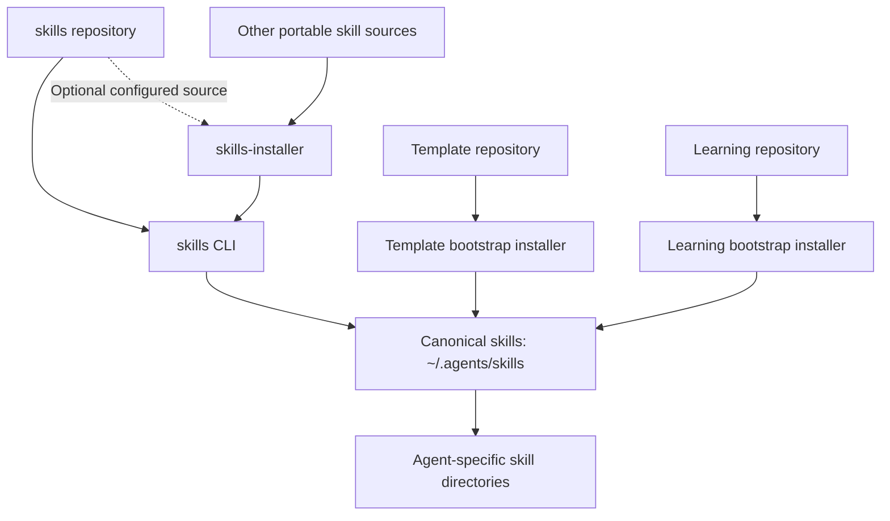
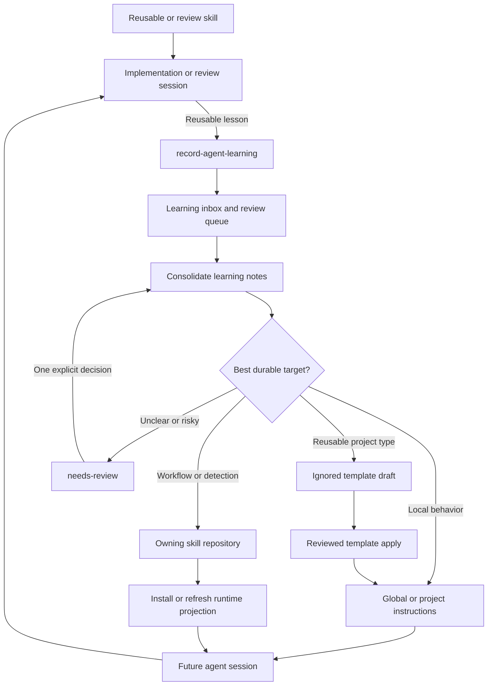

# Agent Ecosystem Architecture and Improvement Proposal

This document defines how four related repositories cooperate to provide agent
instructions, reusable skills, installation, and a durable learning feedback
loop. It also records the current architecture weaknesses and the preferred
improvement sequence.

## Table of Contents

- [Purpose](#purpose)
- [Project Responsibilities](#project-responsibilities)
- [Distribution Architecture](#distribution-architecture)
- [Learning Feedback Loop](#learning-feedback-loop)
- [Source Ownership Contract](#source-ownership-contract)
- [Current Weak Points](#current-weak-points)
- [Improvement Proposal](#improvement-proposal)
- [Adoption Plan](#adoption-plan)
- [Acceptance Criteria](#acceptance-criteria)
- [Related Documentation](#related-documentation)

## Purpose

The ecosystem has four distinct responsibilities:

1. Author reusable workflow skills.
2. Compose persistent agent instructions for projects.
3. Install skills into a shared canonical layer and agent-specific runtimes.
4. Capture real lessons and route them back to the smallest durable source.

These responsibilities are related but should not be collapsed into one
repository. The important boundary is that repositories own durable source,
while installed skill directories are runtime projections of that source.

## Project Responsibilities

| Repository | Owns | Does Not Own |
| --- | --- | --- |
| [`marcomc/skills`](https://github.com/marcomc/skills) | General reusable `SKILL.md` packages and their bundled resources | Cross-agent installation state, instruction templates, or the learning store |
| [`marcomc/agents-file-templates-and-skills`](https://github.com/marcomc/agents-file-templates-and-skills) | Curated instruction templates, template selection, generated project instructions, and two template-maintenance skills | General skill curation or learning-note orchestration |
| [`marcomc/skills-installer`](https://github.com/marcomc/skills-installer) | Configured skill discovery, canonical installation, and fanout links | Skill content, template curation, or learning decisions |
| [`marcomc/agent-learning-system`](https://github.com/marcomc/agent-learning-system) | Learning capture, review queues, consolidation, routing, recurrence analysis, and template handoffs | General skill publication, template approval, or source repository release management |

The learning system and template repository form the core auto-learning
pipeline. The general skills repository and skills installer are adjacent
participants: skills produce findings and receive improvements, while the
installer redistributes approved source content.

## Distribution Architecture

This flow shows the current installation responsibilities and their shared
canonical skill layer.



The specialized installers currently remain necessary:

- The template installer records the template repository location for copied
  skills so they can find `templates.yml` and the curated template tree.
- The learning installer writes learning-store configuration, installs its two
  skills, and creates or updates scheduled automation records.
- `skills-installer` is appropriate for portable skill sources whose runtime
  payload is self-contained or explicitly linked to an available checkout.

Do not replace a specialized installer with generic copy mode until the generic
installer can preserve the repository-specific metadata and companion assets
required at runtime.

## Learning Feedback Loop

This flow shows how real work produces learning and how approved improvements
return to future agent sessions.



Several skills in `marcomc/skills` contain an external
`record-agent-learning` hook. Those hooks make the learning repository a
capability provider for the general skills repository. They do not transfer
source ownership: improvements to a general skill still belong in
`marcomc/skills`.

## Source Ownership Contract

The durable update order should be:

```text
resolve owning source
        -> edit owning source
        -> validate owning source
        -> refresh canonical installation
        -> verify agent fanout
```

An installed directory under `${HOME}/.agents/skills` is not automatically the
source of truth. It may be:

- a copy created from a remote repository;
- a copy created by a specialized local installer;
- a symlink to a local checkout;
- a locally modified runtime copy with no recorded provenance.

Before learning consolidation changes a reusable skill, it should resolve the
owner and installation mode. The safe outcomes are:

| Ownership State | Action |
| --- | --- |
| Writable repository source known | Edit and validate the source, then refresh the installed copy |
| Canonical entry is a symlink to a source | Edit the resolved source and validate it |
| Remote source known but no writable checkout | Create a review proposal; do not treat an installed-only edit as durable |
| Source unknown or ambiguous | Move the lesson to `needs-review` or record an explicit local override |
| Intentionally local skill | Record local ownership metadata before applying the change |

This contract prevents a later installer run from silently replacing learned
improvements that existed only in a runtime copy.

## Current Weak Points

### Missing Cross-Project Source Map

The learning and template repositories document their two-repository pipeline,
but no previous canonical document included the general skills repository and
skills installer. This document establishes that broader map.

### Unrecorded Skill Provenance

The canonical skill layer does not have a shared ownership manifest. The
learning system can identify a useful installed target but cannot reliably
answer:

- which repository owns it;
- whether it was copied or linked;
- which revision was installed;
- which installer manages it;
- whether the runtime copy has drifted from its source.

Installed/source drift has been observed during live audits. Counts are not
recorded here because they are workstation-specific and change over time.

### Installed-Only Learning Can Be Overwritten

Consolidation currently permits promotion into the smallest relevant reusable
skill. Without provenance resolution, this can update only
`${HOME}/.agents/skills/<skill>`. A later direct install or
`skills-installer` copy refresh may replace the change.

### External Learning Hook Is Underspecified

General skills can invoke `record-agent-learning`, but installing
`marcomc/skills` alone does not install the learning system. The public skill
contract needs to state that learning capture is optional and define the
behavior when the external skill is unavailable.

### Overlapping Installer Responsibilities

Three mechanisms can write the canonical skill layer:

- direct `skills` CLI installation;
- `skills-installer` orchestration;
- repository-specific template and learning installers.

Their ownership, backup, conflict, and provenance rules are not yet governed by
one shared contract. The specialized installers also have requirements that a
generic installer cannot currently reproduce.

### Runtime Audits Do Not Verify Sources

`audit-rules` checks global instructions and installed skills for duplicates or
conflicts. It does not compare installed skills with their repository sources,
so it cannot distinguish a deliberate local override from accidental drift.

## Improvement Proposal

### P0: Correct and Publish the Documentation Contract

1. Keep this document as the canonical four-project architecture map.
2. Link it from the learning README and the two-repository automation runbook.
3. Keep command examples executable; plain `prepare-run` already returns JSON.
4. Publish the architecture documentation on the default branch before treating
   it as the public contract.

### P1: Add a Shared Skill Provenance Manifest

Each installer should write or update one machine-readable record for every
canonical skill entry. A record should include at least:

| Field | Purpose |
| --- | --- |
| `skill_name` | Stable canonical skill name |
| `canonical_path` | Installed runtime path |
| `source_id` | Repository URL, package identifier, or local-owner identifier |
| `source_path` | Writable local source when one exists |
| `source_revision` | Commit or source revision used for the install |
| `install_mode` | `copy`, `symlink`, or explicit local override |
| `installer` | Tool or repository that owns refresh behavior |
| `installed_at` | Audit timestamp |

The manifest location and update locking must be shared by
`skills-installer`, the template installer, and the learning installer before
it becomes authoritative.

### P1: Make Learning Promotion Source-First

Before editing a reusable skill, consolidation should:

1. Resolve provenance from the canonical symlink or shared manifest.
2. Compare the installed payload with the owning source.
3. Stop for review when the source is unknown or both copies changed.
4. Apply the lesson to the owning source.
5. Run that repository's validation contract.
6. Refresh the canonical copy through its owning installer.
7. Verify every configured fanout link.

An installed-only edit should require an explicit `local-override` decision and
must not be reported as an upstreamed durable improvement.

### P1: Document the External Learning Capability

The general skills repository should identify
`marcomc/agent-learning-system` as the provider of
`record-agent-learning`. Hooked skills should specify:

- capture runs only when the external skill is installed and available;
- absence of the learning skill does not fail the primary review workflow;
- clean, routine, or no-op sessions do not create notes;
- installation uses the learning repository's bootstrap while it depends on
  repository scripts, configuration, and automations.

### P2: Define the Installer Boundary

Use `skills-installer` for portable general and third-party sources. Retain a
specialized bootstrap when a repository must also install configuration,
automation records, template trees, or other companion assets.

Longer term, the specialized installers may delegate canonical copy and fanout
operations to a shared installer interface. They should keep ownership of their
repository-specific configuration and runtime setup.

### P2: Add Source Drift Auditing

Extend the audit workflow with a read-only source check that reports:

- `exact`: installed payload matches its recorded source;
- `drift`: installed and source payloads differ;
- `missing-source`: the recorded source cannot be resolved;
- `missing-runtime`: the source exists but the canonical entry is absent;
- `wrong-owner`: multiple installers claim the same canonical skill;
- `wrong-fanout`: an agent link does not point through the canonical entry.

The audit should report proposed actions but must not overwrite either side.

## Adoption Plan

| Phase | Scope | Repositories |
| --- | --- | --- |
| 0 | Publish the architecture, correct invalid commands, and document optional dependencies | `agent-learning-system`, `skills` |
| 1 | Define the provenance schema and source-first promotion behavior | `agent-learning-system`, `skills-installer` |
| 2 | Make all installers write compatible ownership metadata | All four repositories |
| 3 | Add source drift and fanout auditing | `agent-learning-system`, `skills-installer` |
| 4 | Evaluate shared installer primitives without removing specialized bootstrap behavior | `skills-installer`, template and learning repositories |

Each phase should remain independently useful. Do not delay the documentation
and source-first safety rules while waiting for a unified installer design.

## Acceptance Criteria

The architecture is materially stronger when all of the following are true:

- Every canonical skill can be traced to one owning source and installer.
- Consolidation never reports an installed-only reusable edit as durable unless
  it is explicitly marked as a local override.
- Repository-source and installed-copy drift is visible through a read-only
  audit.
- Reinstalling skills does not silently remove previously promoted lessons.
- Public skills treat learning capture as an optional external capability.
- Template and learning bootstrap requirements remain functional.
- All four repositories link to one canonical ecosystem description.
- Validation examples execute exactly as documented.

## Related Documentation

- [Composable learning architecture](composable-learning-architecture.md)
- [Auto-learning pipeline automations](auto-learning-pipeline-automations.md)
- [Project README](../README.md)
- [Template composition model](https://github.com/marcomc/agents-file-templates-and-skills/blob/main/docs/composable-agent-instructions.md)
- [Skills installer workflow](https://github.com/marcomc/skills-installer#install-workflow)
- [General skill relationships](https://github.com/marcomc/skills#skill-relations)
